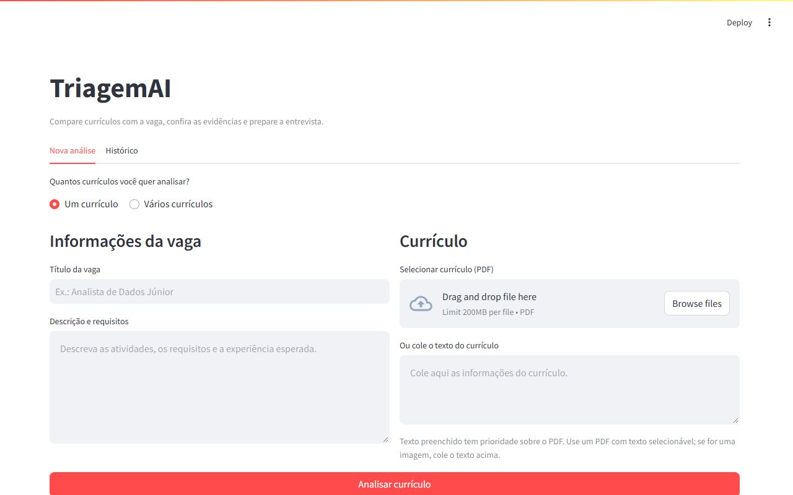

# TriagemAI

MVP acadêmico de triagem de currículos com Python, Streamlit e Google Gemini.
Compara os requisitos de uma vaga com evidências profissionais do currículo e
sugere perguntas para a entrevista. A pontuação indica aderência documental e
apoia a revisão humana; não determina contratação ou rejeição.

## Interface



Captura real da interface local em 1280 × 800, sem avaliação em andamento.
As telas de resultados na documentação complementar usam dados fictícios e
respostas simuladas; não comprovam execução real do Gemini.

## Funcionalidades implementadas

- **Análise individual:** PDF com texto selecionável ou currículo colado no formulário.
  O texto preenchido tem prioridade sobre o PDF.
- **Análise em lote:** de 1 a 10 PDFs para a mesma vaga, processados um por vez.
  Falhas individuais não interrompem os demais arquivos nem recebem score artificial.
- **Avaliação com evidências:** requisitos demonstrados, pontos a esclarecer, resumo
  e exatamente três perguntas técnicas. A avaliação completa, os componentes da
  pontuação e os logs ficam em **Detalhes técnicos da análise**.
- **Ranking:** somente avaliações completas, em ordem decrescente de score validado.
  Empates mantêm a ordem de envio; a ordenação é feita em Python.
- **Histórico SQLite:** salvamento explícito, consulta e exclusão com confirmação.
  Consultar uma avaliação salva preserva a análise atual.
- **Exportação CSV:** disponível na análise atual e no histórico, sem nova inferência.

Na aba **Nova análise**, preencha título e descrição/requisitos da vaga, escolha
**Um currículo** ou **Vários currículos** e clique no botão de análise.
PDFs corrompidos, vazios ou sem texto recebem uma orientação; não há OCR.
O resultado fica na sessão do Streamlit. Alterar entradas ou modo invalida a
avaliação anterior; use **Salvar no histórico** para mantê-la após encerrar a sessão.
Repetir o salvamento da mesma execução não duplica nem sobrescreve o registro.

Na aba **Histórico**, selecione o registro e use **Abrir avaliação**. A exclusão
exige abrir **Excluir avaliação salva**, conferir o registro e marcar a confirmação.
Ela não apaga CSVs já baixados nem a avaliação atual da sessão.

O CSV tem uma linha por candidato válido e nove colunas: posição (vazia no modo
individual), nome, vaga, score, classificação, resumo e três perguntas. Usa `;`,
UTF-8 com BOM, campos entre aspas e quebras CRLF. Textos que possam ser interpretados
como fórmulas recebem uma tabulação no campo exportado, sem alterar a sessão ou o banco.
No Excel, importe como UTF-8 e selecione apenas ponto e vírgula como delimitador.
O comportamento da proteção depende do importador e pode mudar após editar o CSV.

## Pipeline P01 → P02 → P03

O processamento é sequencial, com papéis definidos para cada prompt:

| Etapa | Responsabilidade |
|---|---|
| **P01 — Extração** | Estrutura dados profissionais, experiências e projetos com trechos de evidência. Preserva informações desconhecidas conforme o contrato, sem calcular durações ausentes. |
| **P02 — Aderência** | Compara requisitos explícitos da vaga com os dados profissionais de P01, registra situação, evidência e esclarecimento e produz os componentes da pontuação e o score. |
| **P03 — Parecer** | Resume a avaliação, apresenta a classificação e gera exatamente três perguntas técnicas, sem produzir outro score. |

Cada JSON passa por validação Pydantic antes do avanço. Tipos incorretos, campos
extras, evidências não localizadas, pontuação incoerente ou classificação
incompatível interrompem a análise daquele currículo. O nome é omitido das entradas
de P02/P03. Os logs registram etapas, contagens e erros genéricos, sem nomes,
arquivos ou respostas brutas.

O modelo configurado é `gemini-2.5-flash`. Uma análise completa usa três chamadas,
com uma única tentativa por chamada no SDK, sem retries automáticos. Abrir detalhes,
salvar, consultar o histórico e exportar não executa o modelo.

## Tecnologias e arquitetura

| Tecnologia | Uso |
|---|---|
| Python e Streamlit | Interface local, sessão e ações do usuário |
| Google Gen AI SDK | Comunicação com a API Gemini |
| Pydantic | Contratos de saída e validações |
| pypdf | Extração de texto nativo de PDFs, preservando a separação entre páginas |
| python-dotenv | Carregamento da configuração local |
| SQLite, CSV e unittest | Persistência, exportação e testes com a biblioteca padrão |

```text
app.py              Interface Streamlit e sessão
pipeline.py         Extração de PDF, contratos e pipeline P01 → P02 → P03
persistencia.py     Histórico SQLite e exportação CSV
requirements.txt    Dependências de execução
.env.example        Exemplo de configuração, sem credencial real
tests/              Testes automatizados com dados sintéticos
evidencias/         Capturas e registros de validação
data/triagem.db     Banco local criado automaticamente; ignorado pelo Git
```

Não há ORM ou serviço externo de armazenamento. A interface, o histórico e a
exportação executam localmente. **Novas avaliações enviam o texto do currículo e
o contexto da vaga à API do Google Gemini.**

## Instalação local no Windows e Linux

Instale Git e **Python 3.12**, versão usada nos testes. O clone de um repositório
privado exige uma conta autorizada no GitHub. A instalação precisa de internet
para baixar as dependências. Os comandos usam o Python do ambiente virtual
diretamente, sem ativação ou alteração da política do PowerShell.

### Windows PowerShell

Com Python 3.12 e o launcher `py` instalados:

```powershell
git clone https://github.com/Carlos-ccaetano/Triagem-ai.git
Set-Location Triagem-ai
py -3.12 -m venv .venv
.\.venv\Scripts\python.exe -m pip install -r requirements.txt
if (-not (Test-Path -LiteralPath .env)) { Copy-Item -LiteralPath .env.example -Destination .env }
notepad .env
.\.venv\Scripts\python.exe -m streamlit run app.py --server.address 127.0.0.1 --browser.gatherUsageStats false
```

### Linux ou WSL

Use um `python3` da versão 3.12. Se a distribuição não incluir `venv`/`ensurepip`,
instale esse suporte antes de criar o ambiente.

```bash
git clone https://github.com/Carlos-ccaetano/Triagem-ai.git
cd Triagem-ai
python3 -m venv .venv
.venv/bin/python -m pip install -r requirements.txt
cp -n .env.example .env
nano .env
.venv/bin/python -m streamlit run app.py --server.address 127.0.0.1 --browser.gatherUsageStats false
```

Abra [http://127.0.0.1:8501](http://127.0.0.1:8501) e encerre o servidor com `Ctrl+C`.

### Chave, fuso e dados locais

No editor, substitua o marcador de `GEMINI_API_KEY` em `.env` pela sua chave.
Uma variável já configurada no processo tem precedência sobre o arquivo.
Não compartilhe a chave; confirme que `.env` está ignorado com `git check-ignore .env`.
Sem chave, novas análises ficam desabilitadas; histórico e CSV continuam disponíveis.
Análises reais podem consumir quota/créditos da API.

O histórico armazena datas em UTC e as exibe em `America/Sao_Paulo`. No Windows,
`requirements.txt` instala `tzdata` para fornecer a base IANA usada por `ZoneInfo`.
Sem essa base, registros salvos podem ficar inacessíveis pela interface, mesmo que o
banco esteja íntegro. No Linux, os dados de fuso devem estar disponíveis no sistema.
Veja a [documentação do Python sobre as fontes de fuso](https://docs.python.org/3.12/library/zoneinfo.html#data-sources).

O banco é criado em `data/triagem.db`, relativo a `persistencia.py`, sem caminho
fixo de outro computador. Guarda vaga, data, modo, nome identificado, P02, P03 e
contagem de falhas. Não guarda PDFs, currículo integral, P01 completo, nomes de
arquivos, chaves, logs ou respostas brutas. **Nomes e evidências ainda podem
identificar pessoas.** Não há autenticação, criptografia ou backup automático.
O clone não transfere chaves, avaliações ou CSVs locais: cada instalação começa
com seu próprio banco vazio.

## Pontuação e interpretação

| Categoria | Peso |
|---|---:|
| Requisitos obrigatórios | 70 |
| Experiência e senioridade | 20 |
| Desejáveis | 10 |

Somente categorias com requisitos expressos na vaga entram no cálculo. Cada requisito
tem o mesmo peso dentro da categoria e é avaliado uma única vez. Experiência e
senioridade usam a categoria própria; requisitos sem categoria explícita vão para
obrigatórios.

- **`demonstrado`:** evidência suficiente; recebe crédito documental.
- **`nao_informado`:** informação insuficiente; exige esclarecimento na entrevista.
- **`nao_atendido`:** incompatibilidade explícita; exige evidência e esclarecimento.

As duas últimas situações recebem zero crédito. Omissão no currículo não significa
ausência de competência. Listar uma tecnologia não comprova aplicação prática ou
duração quando o requisito exige essas informações.

P02 calcula `pontos da categoria = peso × demonstrados / avaliados`, com duas casas
decimais, e `score = 100 × soma dos pontos / soma dos pesos presentes`, arredondado
a inteiro. Metades são arredondadas para cima. Python confere e rejeita incoerências;
não substitui a pontuação do modelo. Sem requisito avaliável, não há score válido.

| Score e condições | Classificação documental |
|---|---|
| Abaixo de 50 | Não Recomendado |
| De 50 a 84 | Recomendado com Ressalvas |
| A partir de 85, com todos os obrigatórios demonstrados | Altamente Recomendado |
| A partir de 85, com pendência obrigatória | Recomendado com Ressalvas |

Exemplo sintético: `70/70 + 0/20 + 10/10 = 80/100`, com ressalvas. Uma vaga somente
com obrigatórios demonstrados dá `70/70`, normalizado para `100/100`.
São faixas acadêmicas, sem estudo de validade preditiva ou acurácia.

## Testes e validação

### Windows PowerShell

```powershell
.\.venv\Scripts\python.exe -m unittest discover -s tests -v
.\.venv\Scripts\python.exe -m pip check
.\.venv\Scripts\python.exe -m compileall -q app.py pipeline.py persistencia.py tests
git diff --check
```

### Linux ou WSL

```bash
.venv/bin/python -m unittest discover -s tests -v
.venv/bin/python -m pip check
.venv/bin/python -m compileall -q app.py pipeline.py persistencia.py tests
git diff --check
```

Os testes usam currículos sintéticos, Gemini simulado, bancos temporários e rede
bloqueada. Cobrem contratos, rubrica, PDFs, erros, sessão, lote, ranking, histórico
e CSV. AppTest não substitui a inspeção no navegador nem o teste com a API real.

Nesta revisão, **71 testes passaram no Windows nativo com Python 3.12.16**:
os 70 existentes e uma regressão que confere o horário de São Paulo na seleção
e na abertura do histórico sem chave. `pip check`, compilação e `git diff --check`
também passaram, sem chamadas reais ao Gemini.

O ambiente registrado na validação anterior usou Python 3.12.3, Streamlit 1.39.0,
google-genai 3.4.0, pypdf 7.1.0, Pydantic 2.14.3 e python-dotenv 1.2.4.
Streamlit permanece fixado em 1.39.0; o SDK foi fixado na versão documentada,
pois o mínimo anterior, 1.0.0, não aceita `retry_options` usado pela aplicação.
As demais dependências mantêm limites mínimos: o arquivo não fixa todo o ambiente.
Para repetir as versões diretas documentadas, acrescente `"pypdf==7.1.0"`
`"pydantic==2.14.3"` `"python-dotenv==1.2.4"` ao comando de instalação.
Outras linhas do Python e todas as versões mínimas não foram validadas.

## Limitações e documentação complementar

A integração real com Gemini permanece pendente: os ensaios desta entrega não fazem
chamadas reais. Qualidade semântica, latência, acurácia e vieses não foram medidos.
Conferir trechos não prova autenticidade, relevância ou cobertura de todos os requisitos.
Instruções de sistema e validações reduzem interferências de comandos nos dados, sem
garantir imunidade a prompt injection. A revisão humana continua necessária.

Não há OCR, envio de e-mail, autenticação, prompts P04–P06 ou deploy.

- [Validação final e confronto com a documentação acadêmica](VALIDACAO_FINAL.md):
  resultados históricos, escopo e limitações dos ensaios.
- [Interface e comparação visual](evidencias/ui-humanizacao/README.md):
  capturas reais com dados sintéticos e validação dos 70 testes da base.
- [Roteiro mínimo de validação real](VALIDACAO_FINAL.md#procedimento-mínimo-para-validação-real):
  procedimento futuro com currículo fictício; não executado nesta revisão.
