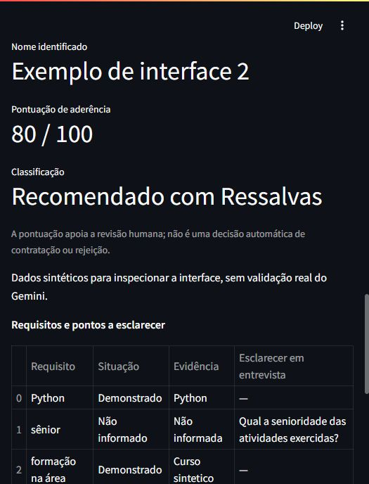
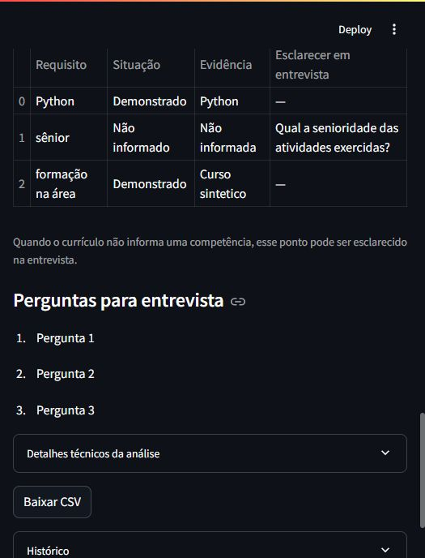

# Validação final do TriagemAI — Etapa 06

Data: 17/11/2026. Diretório: `/home/carloscaetano/estudos/Triagem-ai`.
Base: Etapa 05, `aaed1f9b608458b5ac56fd5034c83957052c925d`.
Branch: `codex/etapa-06`.

**Diagnóstico:** a suíte passou e os fluxos locais foram exercitados com dados sintéticos.
O aceite completo da Etapa 06 permanece **pendente**, pois não houve integração real com
Gemini. A chave estava ausente no WSL, sem `.env`; o usuário escolheu continuar com essa
integração pendente. **0 de até 9 chamadas reais utilizadas.**

## Critérios e evidências

| Critério | Resultado | Evidência e alcance |
|---|---|---|
| Estado inicial e histórico Git | Aprovado | Checkout limpo em `aaed1f9`; branch criada dessa base; `git fsck --full` sem erros; refs anteriores preservadas. |
| Testes anteriores | Aprovado | 66 testes passaram em 11,774 s antes da correção. Seus arquivos não foram alterados. |
| Suíte após a correção | Aprovado | 67 testes passaram em 11,430 s, com Gemini simulado e conexões de rede bloqueadas. |
| Contratos P01/P02/P03 | Aprovado com ressalvas | Casos simulados rejeitam JSON inválido, evidência não localizada, score e classificação incoerentes; sem verificação semântica do modelo real. |
| PDFs e alternativa manual | Aprovado | Testes de arquivo vazio/corrompido, sem páginas/texto, várias páginas e prioridade do texto manual. Seleção de upload é simulada no AppTest. |
| Lote e ranking | Aprovado com ressalvas | Testes de 1 a 10 PDFs, recusa de 11 antes das chamadas, ordem decrescente, empates estáveis, zero válido e isolamento de falhas; modelo simulado. |
| Sessão e reexecuções | Aprovado | Testes de invalidação, substituição, erro sem sucesso antigo e detalhes sem novas chamadas; inspeção do histórico também não gerou chamadas. |
| Interface no navegador | Aprovado com ressalvas | Streamlit real: vaga, campos PDF/manual, modos, ranking, seleção, evidências, três perguntas, histórico e downloads. Avaliações pré-salvas sintéticas, sem envio ao modelo. |
| Salvamento pela interface | Aprovado com ressalvas | AppTest verifica clique explícito, repetição sem duplicar e preservação após erro; o salvamento manual no navegador não foi exercitado com resultado novo. |
| SQLite prático | Aprovado | Funções reais salvaram individual e lote; reinício preservou os dois registros; abertura e exclusão confirmada pela interface; restou somente o lote. |
| CSV prático | Aprovado | Downloads individual/lote idênticos aos bytes do exportador; BOM UTF-8, `;`, nove colunas e 1/2 candidatos; três perguntas presentes. |
| CSV no Excel | Aprovado com ressalvas | Importação explícita com UTF-8 e `;`, tabulação desmarcada; lote em nove colunas. `=1+1` e `+1+1` permaneceram texto no caso sintético. Não representa todos os leitores. |
| Privacidade e versionamento | Aprovado com ressalvas | Logs mínimos, ausência de credenciais por padrões conhecidos, dados locais ignorados. Nome e evidências do histórico ainda são identificáveis; não há criptografia. |
| Sintaxe e dependências | Aprovado | `compileall` sem erros; `pip check`: `No broken requirements found.`; `git diff --check` sem problemas considerando CRLF. |
| Integração real com Gemini | Não testado | Chave ausente; nenhuma chamada. P01/P02/P03 reais, coerência semântica, prompt injection real, quota, disponibilidade e latência continuam pendentes. |
| Comparação com documento E4 original | Aprovado | Original localizado em Downloads na revisão de encerramento; conteúdo comparado abaixo e hash preservado. Não foi reexecutada a integração descrita na E4. |

## Defeito comprovado e correção mínima

**Prioridade alta para respeitar o limite de chamadas:** os dois clientes em `app.py`
usavam o retry padrão do SDK. Na versão instalada, `google/genai/_api_client.py` define
`_RETRY_ATTEMPTS = 5` (incluindo a tentativa inicial) e aplica esse padrão quando não há
configuração explícita. Em erros elegíveis, uma etapa poderia consumir mais de uma tentativa
HTTP, contrariando a restrição de não repetir chamadas. Não foi provocada falha real de API.

Correção: `http_options={"retry_options": {"attempts": 1}}` nos clientes individual e lote.
O teste novo percorre os dois modos e confere a configuração e nove invocações **simuladas**.
O SDK local também aceitou a opção via `HttpOptions.model_validate`, sem rede.
Modelo, três prompts, schemas, rubrica, pipeline e persistência permaneceram inalterados.
A revisão não identificou outro defeito comprovado que justificasse mudança de código.

## Verificação prática local

Foi usado um banco isolado em `data/validacao-final/triagem-validacao.db`; o banco padrão
`data/triagem.db` não existia e não foi criado por esse ensaio. Os registros vieram das
fixtures de teste e receberam nomes/títulos/resumos que os identificam como sintéticos.
Não são saídas do Gemini.

1. Salvamento e recuperação pelas funções reais: uma avaliação individual e um lote de dois.
2. Abertura das duas análises no navegador e download dos respectivos CSVs.
3. Encerramento do processo Streamlit e nova inicialização: dois IDs preservados, sem duplicidade.
4. Reabertura da avaliação individual; marcação da confirmação e exclusão pela interface.
5. Consulta direta: um registro restante, ID individual ausente e `PRAGMA integrity_check = ok`.
6. Leitura do lote e do caso aritmético no Excel; encerramento dos arquivos sem regravá-los.

Os CSVs baixados tinham 406 bytes (individual) e 611 bytes (lote), respectivamente duas e
três linhas CSV incluindo cabeçalho. Score, classificação, resumo e três perguntas foram
conferidos. O teste automatizado de exportação confirma que o prefixo contra fórmulas não
altera os dados de origem. Importar com tabulação como delimitador pode distorcer esse formato;
é necessário usar apenas `;` como separador.

Uma medição local de salvar, consultar e exportar levou 0,020438 s para o individual e
0,005772 s para o lote, em uma amostra de cada. Isso não é benchmark nem latência do Gemini.
O servidor de validação foi encerrado. Bancos, CSVs e instrumentação do ensaio permanecem
locais e ignorados pelo Git; não foram incluídos no commit.

- [Registro técnico da verificação prática](evidencias/verificacao-pratica.json)
- [Extrato literal dos 67 testes](evidencias/testes-etapa06.txt)
- Logs integrais locais: `.venv/etapa06-preflight.log` e `.venv/etapa06-tests.log`.

## Capturas reais da interface

Capturas do Streamlit em execução, no viewport normal do navegador. Todos os nomes,
valores e perguntas exibidos vêm de fixtures sintéticas pré-salvas. As imagens demonstram
apresentação e navegação; **não comprovam integração ou qualidade do Gemini**.






## Escopo entregue e limites

O MVP implementa interface Streamlit, PDF/texto individual, pipeline sequencial,
validação Pydantic, rubrica, lote sequencial de até dez PDFs, ranking estável, sessão,
histórico SQLite e CSV. Nesta etapa, a mudança funcional limita-se à desativação de retries.
O README foi consolidado para explicar o sistema entregue e a configuração local da chave.

Não foram implementados OCR, e-mails, autenticação, novos agentes/P04, paralelismo,
infraestrutura adicional ou deploy. Não há estudo de acurácia, vieses ou validade preditiva.
Conferir trechos não garante autenticidade, pertinência ou cobertura de todos os requisitos.
A interpretação semântica depende do modelo e da revisão humana. A proteção CSV observada
no Excel não é garantia universal. O banco não tem backup automático nem criptografia.

Ambiente medido: Python 3.12.3, Streamlit 1.39.0, google-genai 3.4.0, pypdf 7.1.0,
Pydantic 2.14.3 e python-dotenv 1.2.4. Não foram testadas outras plataformas ou todas as
versões mínimas permitidas em `requirements.txt`.

Ao terminar a validação técnica da Etapa 06, `main` e a tag `baseline-inicial-2026-11-17`
estavam em `41028c1`, com as branches Etapas 01–05 preservadas e sem publicação naquele
momento. A consolidação posterior autorizada no GitHub está registrada ao final deste relatório.

Para completar o aceite, configure a chave localmente conforme o README e execute a análise
individual e o lote de dois currículos fictícios dentro do limite autorizado, sem retries.
Só então será possível registrar P01/P02/P03 reais e o fluxo completo até SQLite e CSV.


## Revisão de encerramento

Revisão de conteúdo em 17/11/2026, sobre o commit técnico `d42e90f0a918d530b5f0be51ccdf233f7416493b`.
O original foi localizado em `C:/Users/CarlosCaetano/Downloads/Entrega4.docx`, com 33.863 bytes.
SHA-256: `20eb4fb6634be437ceec1e15b6a33d037b119e5cd55125d977c527020611ec26`.
Foram lidos texto e tabelas das seções 2–7. Não houve revisão de diagramação, edição ou
cópia do documento para o repositório. A indicação anterior de indisponibilidade foi atualizada.

As classificações abaixo se referem à implementação atual. **Implementado e validado**
indica evidência local/automatizada dentro do escopo descrito, sem incluir inferência real
quando o item depende do Gemini. Os registros da E4 são tratados como documentação
histórica, sem nova confirmação independente das chamadas ali relatadas.

### Funcionalidades F01 a F08

Fonte: E4, seção 3.1, confrontada com `app.py`, `pipeline.py`, `persistencia.py` e testes.

| Item | E4 | Classificação atual e diferença |
|---|---|---|
| F01 — Cadastro da vaga | Formulário funcional, validação de campos vazios | **Implementado e validado.** Título e descrição/requisitos; campos vazios impedem o processamento. |
| F02 — Extração P01 | Declarada funcional com LLM real | **Implementado, aguardando teste real.** Dados profissionais, experiências e evidências; contrato estrito e testes simulados. |
| F03 — Aderência P02 | Declarada funcional com LLM real | **Implementado, aguardando teste real.** Requisitos, evidências e rubrica 70/20/10, com rejeição de incoerências. |
| F04 — Parecer P03 | Parecer e três perguntas; a tabela atribui a ele o cálculo do score | **Implementado, aguardando teste real.** P03 só resume/classifica e produz três perguntas; score pertence exclusivamente a P02. |
| F05 — PDF individual | Parcial; falha em PDF escaneado | **Implementado e validado** para PDF nativo. Várias páginas, erros seguros e alternativa manual; OCR permanece fora do escopo. Não há garantia de leitura semântica correta de toda diagramação. |
| F06 — Lote | Lista fixa de três candidatos simulados | **Implementado, aguardando teste real.** De 1 a 10 PDFs passam pelo mesmo pipeline sequencial; lógica, limites, falhas e ranking validados sem API. Não há lista fixa na aplicação atual. |
| F07 — Histórico | Pendente; somente sessão | **Implementado e validado.** SQLite local, salvamento explícito, recuperação e exclusão confirmada; não salva automaticamente. |
| F08 — E-mail | Pendente; documento menciona uma prévia sem SMTP | **Fora do escopo aprovado do MVP.** Não há envio nem prévia de e-mail implementados na versão atual. |

### Prompts P01 a P06

Fonte: E4, seção 3.2 e anexos A–C.

| Prompt | E4 | Classificação atual e diferença |
|---|---|---|
| P01 | Papel de extração e exemplo de JSON | **Implementado, aguardando teste real.** Mantém extração com exemplo; amplia contrato com experiências e trechos verificáveis. |
| P02 | Descrito como Chain of Thought, com score | **Implementado, aguardando teste real.** Produz conclusões objetivas, evidências e score; não solicita raciocínio privado. A chave legada `analise_passo_a_passo` foi preservada por compatibilidade. |
| P03 | Papel de RH, resumo e entrevista | **Implementado, aguardando teste real.** Até quatro linhas e exatamente três perguntas, sem recalcular score; classificação conferida em Python. |
| P04 | CoVe com falha por reescrever o JSON | **Fora do escopo aprovado do MVP.** Não implementado. Pydantic e conferência textual são controles locais, não uma implementação de CoVe ou verificação semântica completa. |
| P05 | Ranking com Least-to-Most, pendente | **Fora do escopo aprovado do MVP** como prompt. Não implementado; a funcionalidade de ranking usa **Python**, em `executar_lote`, ordenando `score_aderencia` validado com `list.sort(reverse=True)`. Não gera nova pontuação nem faz chamada de IA para ordenar. |
| P06 | E-mail de feedback, pendente | **Fora do escopo aprovado do MVP.** Não implementado; sem geração de e-mail ou integração SMTP. |

### Arquitetura e tecnologias

A própria seção 2.2 da E4 descreve um pipeline sequencial em Python. O título do projeto
menciona agentes, mas isso não corresponde a agentes autônomos independentes no código atual.
A divisão permanece simples: interface em `app.py`, extração/contratos/prompts em
`pipeline.py` e SQLite/CSV em `persistencia.py`. Não foram adicionados frameworks.

| Item da E4 | Situação atual | Classificação |
|---|---|---|
| Python 3.12, Streamlit 1.39.0 e execução local | Mantidos; Python 3.12.3 e Streamlit 1.39.0 medidos na Etapa 06 | Implementado e validado |
| Orquestração sequencial Python | P01 → P02 → P03, sem agentes autônomos | Implementado e validado quanto ao encadeamento; inferência aguardando teste real |
| Gemini `gemini-2.5-flash` e SDK Google Gen AI | Mesmo modelo; SDK 3.4.0 no ambiente registrado; uma tentativa por chamada | Implementado, aguardando teste real |
| pypdf, Pydantic e python-dotenv | Extração nativa, contratos e carregamento local de configuração | Implementado e validado pelos testes aplicáveis; autenticação real ainda pendente |
| `st.session_state` como armazenamento | Mantido para a sessão, complementado por SQLite persistente e CSV | Implementado e validado |

Na E4, seção 2.3, o comando de clone aponta para outro repositório, diferente daquele
informado na identificação do projeto. O README atual usa o diretório WSL correto.
O original foi preservado; seus comandos não foram executados nesta revisão.

### Problemas registrados e planos para E5

Fontes: E4, seções 5 e 6.1–6.3.

| Problema ou plano | Situação atual | Classificação |
|---|---|---|
| Markdown na resposta quebra o parser | MIME JSON e Pydantic rejeitam resposta inválida antes do avanço. Não removem cercas Markdown nem corrigem a resposta automaticamente. Comportamento real do provedor ainda pendente. | Implementado e validado quanto ao bloqueio local |
| PDF sem texto chega ao modelo | Extração rejeita texto vazio, mostra orientação e permite texto manual no individual. O limite sugerido na E4 de 50 caracteres não foi adotado; a guarda exige texto não vazio. | Implementado e validado |
| Latência histórica de cerca de 6–8 s | `st.status` mostra etapas/posição. Não há medição atual do Gemini nem comprovação de redução de latência ou tokens. | Parcialmente implementado |
| Simplificar P04 para inconsistências de datas/experiência | Prompt ausente; controles determinísticos atuais não cobrem toda a semântica proposta. | Fora do escopo aprovado do MVP |
| Substituir lista simulada por lote com progresso | Loop conectado às funções reais, isolando falhas; testado com respostas simuladas. | Implementado, aguardando teste real |
| Evitar perda de histórico e exportar CSV | SQLite e CSV implementados; somente resultados explicitamente salvos persistem após fechar a sessão. | Implementado e validado |
| Bateria com dez currículos reais e métricas | Não realizada. Os testes atuais usam dados sintéticos; não há estudo de acurácia. Esse ensaio não integra o roteiro mínimo fictício abaixo. | Não implementado |
| Slides, ensaio e demonstração ao vivo | Não há slides ou evidência de ensaio no repositório analisado. Preparação acadêmica separada, sem bloqueio técnico do código. | Não implementado |

### Evidências históricas e evidências atuais

A E4 registra quatro casos: dois aprovados (perfil aderente e perfil de outra área), um
parcial (texto desorganizado/JSON) e um reprovado (PDF sem texto). Os anexos A–C contêm
logs textuais apresentados como reais, com score 88 e tempo total de 6,8 s em um exemplo;
o outro caso registra score 5. O DOCX não contém imagens incorporadas. Esses valores não
foram reproduzidos nesta revisão, não são resultados atuais e não constituem taxa de acurácia.
A declaração histórica de cobertura dos três prompts não substitui o teste da versão atual.

Os JSONs dos anexos também não representam os contratos atuais: P01 passou a exigir
`experiencias`; P02 exige avaliações e componentes; P03 usa o literal `Altamente Recomendado`,
enquanto a E4 mostra `Altamente Recomendada`. A tabela F04 atribui score a P03, mas o fluxo
da seção 3.3 o atribui a P02. A versão atual resolve essa ambiguidade: somente P02 o produz.
Não se espera reproduzir scores históricos sob os contratos e a rubrica atuais.

Nesta revisão, os **67 testes passaram novamente em 12,153 s**. Os seis arquivos de teste
foram comparados por SHA-256 com `d42e90f` antes e depois da execução e permanecem idênticos.
Log integral local, ignorado pelo Git: `.venv/revisao-encerramento-testes.log`.
As capturas e o ensaio prático de SQLite/CSV acima continuam sendo evidências da Etapa 06;
não foram refeitos nesta revisão documental. Não houve chamadas ao Gemini.

### Situação da documentação e bloqueios

README e este relatório foram confrontados com o código e continuam coerentes sobre
pipeline, rubrica, PDF/texto, lote, ranking, sessão, SQLite, CSV e ausência de OCR/e-mails.
Foram corrigidos o registro de indisponibilidade da E4 e a falta da referência explícita a
ranking em Python sem P05. Nenhuma taxa de acurácia ou aprovação real por mocks foi acrescentada.

O bloqueio para aceite completo é produzir evidência atual do Gemini: chave válida, acesso
à API/modelo/quota e execução observada. Nesta revisão, não havia `.env` nem variável
`GEMINI_API_KEY` no processo WSL consultado; valores de credenciais não foram exibidos.
Um caso fictício de três chamadas verifica a integração mínima, mas não substitui o aceite
anterior da Etapa 06, que também prevê lote de dois, histórico e CSV com resultados reais.
P04, P05 como prompt, P06, OCR e e-mails não são pendências bloqueantes do escopo aprovado.
Slides/ensaio são uma pendência de apresentação; a bateria histórica com dez currículos não
pode ser declarada realizada. Não se deduz dessa revisão uma nova exigência de implementá-los.

## Procedimento mínimo para validação real

**Roteiro futuro, não executado nesta tarefa.** Uma análise individual completa faz até três
chamadas, P01 → P02 → P03, sem retries. Não use lote nem clique novamente durante esse caso.
Uma falha pode encerrar o fluxo antes da terceira chamada. As chamadas de outro ensaio devem
ser contabilizadas separadamente; este documento não autoriza executá-las nesta revisão.

1. No terminal WSL, configure o arquivo local, sem incluir a chave no comando:

   ```bash
   cd /home/carloscaetano/estudos/Triagem-ai
   cp -n .env.example .env
   nano .env
   git check-ignore .env
   ```

   Substitua o marcador por sua chave dentro do editor. Não use `cat .env`, não cole a chave
   em conversas e não a inclua em logs, imagens ou commits. O nome `.env` deve aparecer como
   ignorado. `load_dotenv()` lê esse arquivo; a aplicação também aceita a variável de ambiente.

2. Inicie a aplicação real, sem patches, fixtures ou o servidor sintético da Etapa 06:

   ```bash
   .venv/bin/python -m streamlit run app.py --server.address 127.0.0.1 --browser.gatherUsageStats false
   ```

   Abra `http://127.0.0.1:8501`. O texto será enviado à API Google, embora a interface execute
   localmente. Confira a branch/commit e mantenha `gemini-2.5-flash`.

3. Escolha **Análise individual** e preencha estes dados exclusivamente fictícios:

   **Título:** Desenvolvedor backend Python.

   **Descrição:** Requisitos obrigatórios: desenvolvimento de APIs com Python e FastAPI;
   consultas SQL em PostgreSQL; testes automatizados. Experiência: ao menos um ano com
   Python. Desejável: Docker.

   **Texto manual do currículo:**

   ```text
   Pessoa Teste 01 — currículo fictício, sem pessoa real associada.
   Desenvolvedor backend. Tenho 2 anos de experiência em desenvolvimento com Python.
   Projeto profissional descrito para teste: entre 2024 e 2026 implementei uma API de
   catálogo usando Python e FastAPI, escrevi consultas SQL em PostgreSQL e testes
   automatizados com unittest. Formação: curso de desenvolvimento de sistemas.
   ```

4. Clique uma única vez em **Analisar currículo**. Em **Detalhes técnicos da análise**,
   confira os registros de validação de P01, P02 e P03. Ausência de erro e os três registros
   demonstram passagem pelos contratos; não comprovam, sozinhos, correção semântica de
   todos os campos extraídos por P01, que não são integralmente exibidos na interface.
   Confira as evidências e o parecer visíveis contra o texto fictício. Não altere os prompts
   para obter um score predeterminado.

| Etapa | Resultado esperado |
|---|---|
| P01 | Estrutura aceita pelo contrato, experiências com trechos existentes e informação desconhecida preservada. Não inventar Docker nem atribuir os dois anos de Python a todas as tecnologias. A confirmação completa campo a campo de P01 exige inspecionar o objeto validado localmente, sem repetir a chamada ou publicar resposta bruta. Se não feita, registre essa limitação. |
| P02 | Requisitos citados da vaga e evidências dos campos profissionais; Docker não informado exige esclarecimento. Componentes e score coerentes com a rubrica 70/20/10 e categorias presentes. Sem exigir nota exata antecipada. |
| P03 | Classificação compatível com score e pendências obrigatórias; resumo de até quatro linhas; exatamente três perguntas técnicas pertinentes. Sem novo score ou decisão automática sobre contratação. |

5. Se o caso passar, use **Salvar no histórico**, reabra o registro e exporte o CSV.
   Confira uma linha de candidato, score, classificação, resumo e três perguntas, sem
   novas chamadas. Isso complementa o caso individual; o lote real de dois continua um
   ensaio separado, de até seis chamadas, necessário para o aceite completo da Etapa 06.
6. Registre somente: data/fuso, commit, modelo, ID sintético do caso, etapas alcançadas,
   estado do contrato por etapa, score/componentes e classificação recebidos, quantidade
   de perguntas, observações qualitativas e tempo total realmente medido. Não derive
   acurácia de um caso. Se não medir, marque tempo como não medido.
7. Em erro de autenticação/quota/modelo/API/schema ou conteúdo incoerente, marque **Falhou**,
   registre última etapa observada e categoria da falha. A interface exibe erro genérico;
   se o código HTTP/tipo não estiver disponível com segurança, registre **não identificado**.
   Não salve traceback, cabeçalhos, credenciais, currículo integral ou resposta bruta.
   Não repita automaticamente, não avance manualmente para a etapa seguinte e não aceite
   um JSON ou score inválido. Reexecução deve ser uma nova tentativa contabilizada.

Um registro de resultado pode ficar em `data/validacao-real/registro.txt`, ignorado pelo Git,
com campos: `data`, `commit`, `modelo`, `caso`, `etapas_observadas`, `contratos`,
`revisao_semantica`, `score_e_componentes`, `classificacao`, `perguntas_quantidade`,
`tempo_total`, `estado_final` e `falha`. No relatório acadêmico, publique somente uma síntese
sem dados pessoais, diferenciando **aprovado**, **falhou** e **não verificado** por critério.


## Consolidação para GitHub

Em 17/11/2026, o remoto `https://github.com/Carlos-ccaetano/Triagem-ai.git` foi consultado
com `git ls-remote` e `git fetch`: estava acessível e sem branches ou tags. O baseline
`41028c1`, a implementação `d42e90f` e a revisão documental `2da66a5` foram preservados.

O commit `495093b` acrescentou instruções de clone/instalação/testes para Linux/WSL e
Windows PowerShell e proteção de documentos acadêmicos e auxiliares SQLite no `.gitignore`.
Código, prompts, rubrica, dependências e os seis arquivos de teste não foram alterados.

Uma cópia isolada desse commit, em outro caminho, recebeu ambiente virtual novo e somente
as dependências de `requirements.txt`. Os **67 testes passaram em 10,738 s**; `pip check`
e compilação passaram. O WSL não tinha `ensurepip`: o pip foi preparado apenas no ambiente
virtual isolado. Em uma instalação Linux nova, é necessário ter o suporte a `venv`/`ensurepip`.
A execução nativa no Windows não foi testada.

Antes do envio, nove commits e seus arquivos foram auditados: não havia `.env`, `.venv`,
bancos, PDFs, CSVs ou documentos Word versionados. A busca por padrões conhecidos de
credenciais não encontrou ocorrências; esse exame não garante detecção de qualquer segredo.
Foram mantidas somente capturas sintéticas e registros técnicos sem currículos integrais.

A `main` avançou por **fast-forward**, sem merge commit, preservando toda a cadeia. Foram
publicadas somente `main` e a tag `baseline-inicial-2026-11-17`, sem force-push ou deploy.
A publicação de `495093b` foi confirmada por nova consulta remota e um clone do GitHub:
branch padrão `main`, tag apontando para `41028c1` e 19 arquivos idênticos. Nesse clone,
o banco vazio foi criado automaticamente e a interface iniciou sem chave, com o cliente
Gemini bloqueado durante a verificação. Nenhuma chamada real ao Gemini foi realizada.

Este registro documental complementa a versão publicada, sem alterar o código validado.
Logs e checkouts desse ensaio ficam em `data/verificacao-publicacao/`, ignorados pelo Git.
O aceite completo do MVP continua dependendo dos ensaios reais descritos neste relatório.

## Refinamento documental e portabilidade Windows

Revisão em 17/11/2026, na branch local `codex/refinamento-readme-portabilidade`,
criada da `main` remota em `539e82184462e3edb24c7845ba786a2dcba3764d`.
O README foi reorganizado com a captura original `evidencias/ui-humanizacao/depois-inicial.jpg`,
inspecionada em 1280 × 800, legível e sem dados pessoais ou avaliações na tela.
Os três módulos da aplicação, os prompts, os contratos e a rubrica permanecem idênticos à base.

### Ensaios locais

Ambiente novo e isolado no Windows nativo, com Python 3.12.16, Streamlit 1.39.0,
google-genai 3.4.0, pypdf 7.1.0, Pydantic 2.14.3, python-dotenv 1.2.4 e tzdata 2026.6.
As versões diretas das bibliotecas repetem o ambiente anterior; o patch do Python
e as dependências transitivas podem diferir. Não foi criado um lock completo.

| Verificação | Resultado |
|---|---|
| Suíte existente, antes do novo teste | 70 testes aprovados em 29,952 s |
| Suíte final | 71 testes aprovados em 21,405 s |
| Novo caso | Histórico sem chave: `12:00 UTC` aparece como `09:00` em São Paulo na seleção e na avaliação aberta; cliente Gemini não chamado |
| Dependências e sintaxe | `pip check`, `compileall` e `git diff --check` aprovados |
| README | Links locais válidos; apenas a captura principal, original e inalterada |
| Gemini real | Zero chamadas; respostas simuladas e rede bloqueada nos testes |

Os logs completos ficam em `.venv/testes-base-windows.log` e
`.venv/testes-refinamento-windows.log`, ignorados pelo Git. Não houve nova inspeção
da aplicação no navegador, ensaio manual de CSV no Excel ou execução da suíte no Linux.
As evidências anteriores dessas plataformas e fluxos continuam com seu alcance original.

### Fuso e dependências

Sem dados IANA, `ZoneInfo("America/Sao_Paulo")` gera `ZoneInfoNotFoundError`.
No aplicativo, isso é capturado como falha de acesso ao histórico ao montar os
rótulos dos registros ou abrir uma avaliação salva; o banco não é danificado.
A falha foi reproduzida no Windows com `-S`, que omite os pacotes instalados.
Com `tzdata`, a mesma conversão foi aprovada. A dependência direta adicionada foi
somente `tzdata; sys_platform == "win32"`. O pandas 2.3.3 também a instala
transitivamente; a declaração explícita evita depender desse detalhe.

Para repetir o diagnóstico no PowerShell, após a instalação descrita no README:

```powershell
# Sem os pacotes instalados: espera-se ZoneInfoNotFoundError no Windows sem base IANA.
.\.venv\Scripts\python.exe -S -c "from zoneinfo import ZoneInfo; ZoneInfo('America/Sao_Paulo')"
# Com tzdata: a conversão deve passar.
.\.venv\Scripts\python.exe -c "from datetime import datetime; from zoneinfo import ZoneInfo; assert datetime.fromisoformat('2026-11-17T12:00:00+00:00').astimezone(ZoneInfo('America/Sao_Paulo')).isoformat() == '2026-11-17T09:00:00-03:00'"
.\.venv\Scripts\python.exe -m unittest discover -s tests -p test_ui.py -k test_historico_exibe_data_em_sao_paulo -v
```

A [documentação do Python](https://docs.python.org/3.12/library/zoneinfo.html#data-sources)
explica a ausência habitual da base IANA no Windows e o uso de `tzdata`.
No Linux, o marcador não instala esse pacote; a base de fusos deve vir do sistema.

O [SDK 1.0.0](https://github.com/googleapis/python-genai/blob/v1.0.0/google/genai/types.py)
não declara `retry_options` em `HttpOptions`, opção usada em `app.py`.
Isso foi conferido também no wheel oficial baixado, sem instalá-lo.
O SDK foi fixado em `3.4.0`, já documentado e usado nos ensaios; a construção local
de `HttpOptions(retry_options={"attempts": 1})` passou sem acesso à API.
Streamlit e os demais limites declarados foram preservados, sem atualização em massa.
Não foram testadas todas as versões mínimas permitidas.

### About do GitHub

A descrição foi atualizada pela API com a autenticação Git existente e confirmada
por nova leitura. O conector não oferecia edição desses metadados e a tentativa
de acesso pelo navegador foi interrompida pela automação antes de qualquer alteração.

> MVP acadêmico de triagem de currículos com Python, Streamlit e Google Gemini. Compara requisitos, apresenta evidências e sugere perguntas para entrevistas.

Os oito topics solicitados já estavam configurados e foram preservados e conferidos:
`python`, `streamlit`, `google-gemini`, `prompt-engineering`, `resume-screening`,
`recruitment`, `sqlite`, `pydantic`. Website confirmado vazio; visibilidade confirmada
privada. A requisição de edição alterou somente `description`.

Na revisão anterior, as alterações ficaram locais para revisão, sem commit ou publicação.
A publicação foi autorizada posteriormente, após nova auditoria do diff e revalidação.

### Revalidação para publicação

Em 17/11/2026, os **71 testes passaram novamente no Windows nativo em 31,226 s**,
com Gemini simulado e rede bloqueada. `pip check`, `compileall` e `git diff --check`
passaram. O SDK instalado corresponde a `google-genai==3.4.0`; o marcador de
`tzdata` foi validado para Windows e Linux e a conversão UTC → São Paulo passou.
Nenhuma dependência foi atualizada. Log local: `.venv/testes-publicacao-windows.log`.

A auditoria confirmou somente os quatro arquivos previstos, preservação dos testes
anteriores e dos módulos da aplicação, imagem e links locais válidos e ausência de
indicadores de caminhos absolutos, credenciais ou dados pessoais nas linhas introduzidas.
Essa inspeção não garante detecção de todo segredo possível.

Esta cópia está dentro da pasta configurada de uma conta OneDrive corporativa.
Arquivos ignorados pelo Git, inclusive `.env`, bancos e CSVs locais, podem ser
sincronizados pelo OneDrive. Não foram abertos, copiados, movidos ou apagados arquivos
de configuração sensível, bancos ou credenciais para esta verificação.
