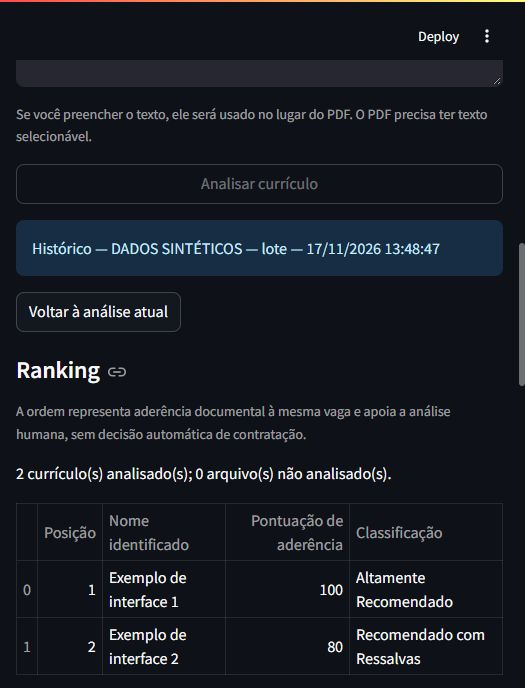

# Validação final do TriagemAI — Etapa 06

Data: 17/11/2026. Diretório: `/home/carloscaetano/estudos/Triagem-ai`.
Base: Etapa 05, `aaed1f9b608458b5ac56fd5034c83957052c925d`.
Branch: `codex/etapa-06`.

**Diagnóstico:** a suíte passou e os fluxos locais foram exercitados com dados sintéticos.
O aceite completo da Etapa 06 permanece **pendente**, pois não houve integração real com
Gemini. A chave estava ausente no WSL, sem `.env`; o usuário escolheu continuar com essa
integração pendente. **0 de até 9 chamadas reais utilizadas.**

## Critérios e evidências

| Critério | Resultado | Evidência e alcance |
|---|---|---|
| Estado inicial e histórico Git | Aprovado | Checkout limpo em `aaed1f9`; branch criada dessa base; `git fsck --full` sem erros; refs anteriores preservadas. |
| Testes anteriores | Aprovado | 66 testes passaram em 11,774 s antes da correção. Seus arquivos não foram alterados. |
| Suíte após a correção | Aprovado | 67 testes passaram em 11,430 s, com Gemini simulado e conexões de rede bloqueadas. |
| Contratos P01/P02/P03 | Aprovado com ressalvas | Casos simulados rejeitam JSON inválido, evidência não localizada, score e classificação incoerentes; sem verificação semântica do modelo real. |
| PDFs e alternativa manual | Aprovado | Testes de arquivo vazio/corrompido, sem páginas/texto, várias páginas e prioridade do texto manual. Seleção de upload é simulada no AppTest. |
| Lote e ranking | Aprovado com ressalvas | Testes de 1 a 10 PDFs, recusa de 11 antes das chamadas, ordem decrescente, empates estáveis, zero válido e isolamento de falhas; modelo simulado. |
| Sessão e reexecuções | Aprovado | Testes de invalidação, substituição, erro sem sucesso antigo e detalhes sem novas chamadas; inspeção do histórico também não gerou chamadas. |
| Interface no navegador | Aprovado com ressalvas | Streamlit real: vaga, campos PDF/manual, modos, ranking, seleção, evidências, três perguntas, histórico e downloads. Avaliações pré-salvas sintéticas, sem envio ao modelo. |
| Salvamento pela interface | Aprovado com ressalvas | AppTest verifica clique explícito, repetição sem duplicar e preservação após erro; o salvamento manual no navegador não foi exercitado com resultado novo. |
| SQLite prático | Aprovado | Funções reais salvaram individual e lote; reinício preservou os dois registros; abertura e exclusão confirmada pela interface; restou somente o lote. |
| CSV prático | Aprovado | Downloads individual/lote idênticos aos bytes do exportador; BOM UTF-8, `;`, nove colunas e 1/2 candidatos; três perguntas presentes. |
| CSV no Excel | Aprovado com ressalvas | Importação explícita com UTF-8 e `;`, tabulação desmarcada; lote em nove colunas. `=1+1` e `+1+1` permaneceram texto no caso sintético. Não representa todos os leitores. |
| Privacidade e versionamento | Aprovado com ressalvas | Logs mínimos, ausência de credenciais por padrões conhecidos, dados locais ignorados. Nome e evidências do histórico ainda são identificáveis; não há criptografia. |
| Sintaxe e dependências | Aprovado | `compileall` sem erros; `pip check`: `No broken requirements found.`; `git diff --check` sem problemas considerando CRLF. |
| Integração real com Gemini | Não testado | Chave ausente; nenhuma chamada. P01/P02/P03 reais, coerência semântica, prompt injection real, quota, disponibilidade e latência continuam pendentes. |
| Comparação com documento E4 original | Não testado | Documento não disponível no repositório ou nos anexos fornecidos. Nenhum documento acadêmico original foi modificado. |

## Defeito comprovado e correção mínima

**Prioridade alta para respeitar o limite de chamadas:** os dois clientes em `app.py`
usavam o retry padrão do SDK. Na versão instalada, `google/genai/_api_client.py` define
`_RETRY_ATTEMPTS = 5` (incluindo a tentativa inicial) e aplica esse padrão quando não há
configuração explícita. Em erros elegíveis, uma etapa poderia consumir mais de uma tentativa
HTTP, contrariando a restrição de não repetir chamadas. Não foi provocada falha real de API.

Correção: `http_options={"retry_options": {"attempts": 1}}` nos clientes individual e lote.
O teste novo percorre os dois modos e confere a configuração e nove invocações **simuladas**.
O SDK local também aceitou a opção via `HttpOptions.model_validate`, sem rede.
Modelo, três prompts, schemas, rubrica, pipeline e persistência permaneceram inalterados.
A revisão não identificou outro defeito comprovado que justificasse mudança de código.

## Verificação prática local

Foi usado um banco isolado em `data/validacao-final/triagem-validacao.db`; o banco padrão
`data/triagem.db` não existia e não foi criado por esse ensaio. Os registros vieram das
fixtures de teste e receberam nomes/títulos/resumos que os identificam como sintéticos.
Não são saídas do Gemini.

1. Salvamento e recuperação pelas funções reais: uma avaliação individual e um lote de dois.
2. Abertura das duas análises no navegador e download dos respectivos CSVs.
3. Encerramento do processo Streamlit e nova inicialização: dois IDs preservados, sem duplicidade.
4. Reabertura da avaliação individual; marcação da confirmação e exclusão pela interface.
5. Consulta direta: um registro restante, ID individual ausente e `PRAGMA integrity_check = ok`.
6. Leitura do lote e do caso aritmético no Excel; encerramento dos arquivos sem regravá-los.

Os CSVs baixados tinham 406 bytes (individual) e 611 bytes (lote), respectivamente duas e
três linhas CSV incluindo cabeçalho. Score, classificação, resumo e três perguntas foram
conferidos. O teste automatizado de exportação confirma que o prefixo contra fórmulas não
altera os dados de origem. Importar com tabulação como delimitador pode distorcer esse formato;
é necessário usar apenas `;` como separador.

Uma medição local de salvar, consultar e exportar levou 0,020438 s para o individual e
0,005772 s para o lote, em uma amostra de cada. Isso não é benchmark nem latência do Gemini.
O servidor de validação foi encerrado. Bancos, CSVs e instrumentação do ensaio permanecem
locais e ignorados pelo Git; não foram incluídos no commit.

- [Registro técnico da verificação prática](evidencias/verificacao-pratica.json)
- [Extrato literal dos 67 testes](evidencias/testes-etapa06.txt)
- Logs integrais locais: `.venv/etapa06-preflight.log` e `.venv/etapa06-tests.log`.

## Capturas reais da interface

Capturas do Streamlit em execução, no viewport normal do navegador. Todos os nomes,
valores e perguntas exibidos vêm de fixtures sintéticas pré-salvas. As imagens demonstram
apresentação e navegação; **não comprovam integração ou qualidade do Gemini**.

## Escopo entregue e limites

O MVP implementa interface Streamlit, PDF/texto individual, pipeline sequencial,
validação Pydantic, rubrica, lote sequencial de até dez PDFs, ranking estável, sessão,
histórico SQLite e CSV. Nesta etapa, a mudança funcional limita-se à desativação de retries.
O README foi consolidado para explicar o sistema entregue e a configuração local da chave.

Não foram implementados OCR, e-mails, autenticação, novos agentes/P04, paralelismo,
infraestrutura adicional ou deploy. Não há estudo de acurácia, vieses ou validade preditiva.
Conferir trechos não garante autenticidade, pertinência ou cobertura de todos os requisitos.
A interpretação semântica depende do modelo e da revisão humana. A proteção CSV observada
no Excel não é garantia universal. O banco não tem backup automático nem criptografia.

Ambiente medido: Python 3.12.3, Streamlit 1.39.0, google-genai 3.4.0, pypdf 7.1.0,
Pydantic 2.14.3 e python-dotenv 1.2.4. Não foram testadas outras plataformas ou todas as
versões mínimas permitidas em `requirements.txt`.

`main` e a tag `baseline-inicial-2026-11-17` permanecem em `41028c1`; branches Etapas 01–05
preservadas. A Etapa 06 foi registrada somente em sua branch local, sem push, merge ou deploy.

Para completar o aceite, configure a chave localmente conforme o README e execute a análise
individual e o lote de dois currículos fictícios dentro do limite autorizado, sem retries.
Só então será possível registrar P01/P02/P03 reais e o fluxo completo até SQLite e CSV.
