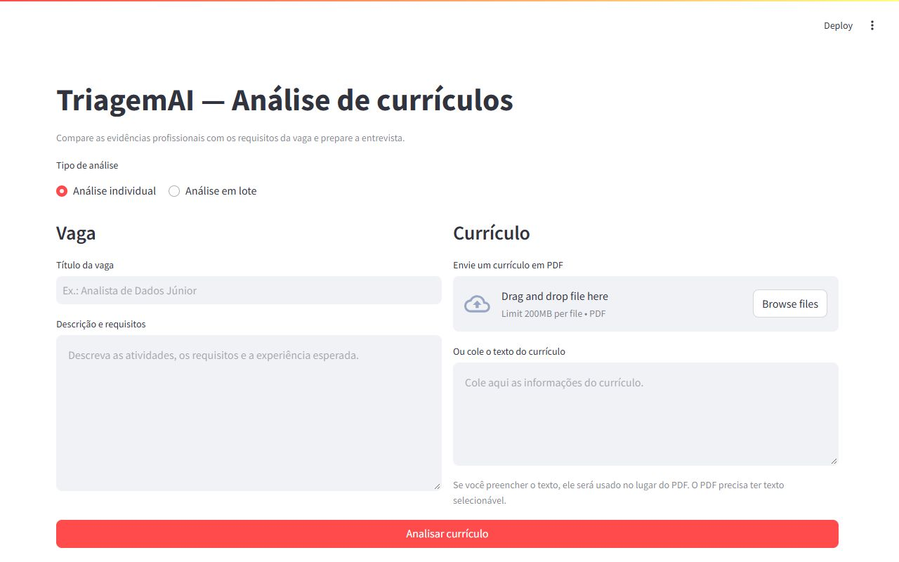
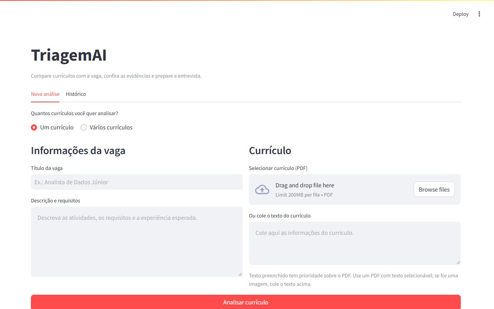
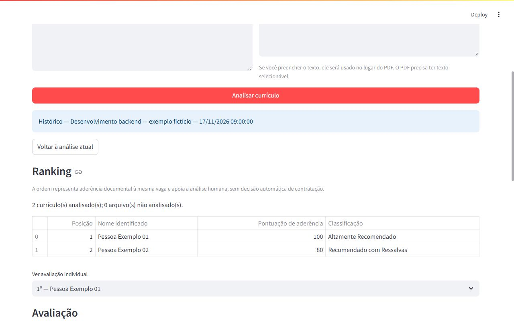
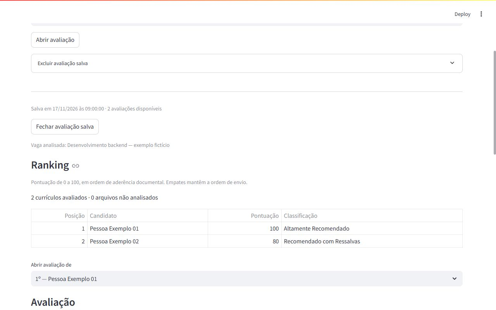
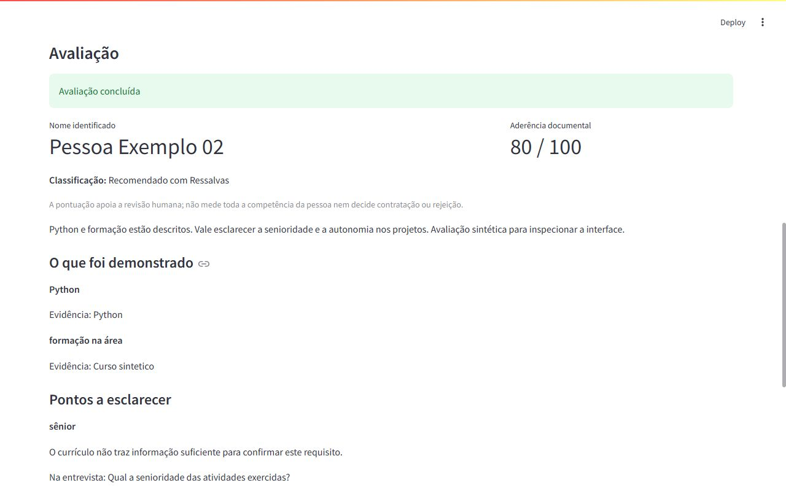
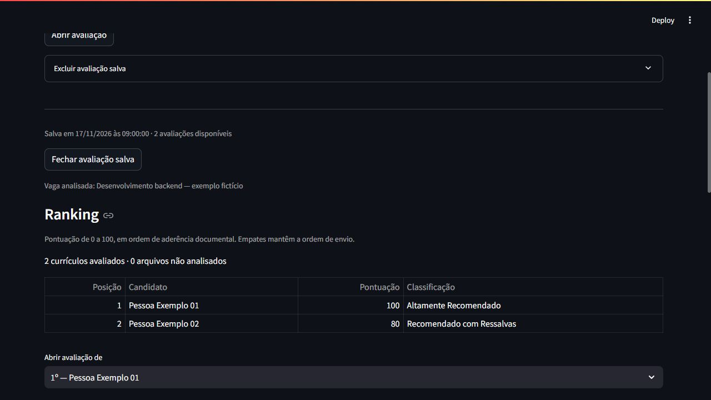
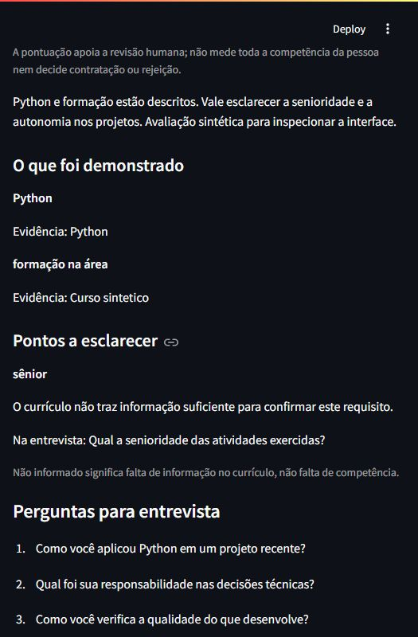
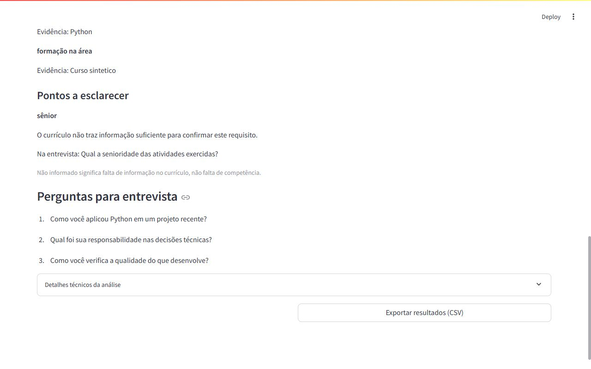

# Refinamento da interface do TriagemAI

Data: 17/11/2026. Base: `91b2a0b`. Branch: `codex/ui-humanizacao`.
A inspeção foi feita no Streamlit local, com respostas simuladas e registros fictícios.
As capturas são reais; os scores, resumos e perguntas são fixtures, não resultados do Gemini.

## Diagnóstico e ajustes

| Observação anterior | Ajuste |
|---|---|
| Histórico depois do formulário e dos resultados, exigindo procurar a seção | Abas nativas Nova análise e Histórico; consultas preservam a análise atual |
| Classificação longa em um componente de métrica grande | Texto normal; nome e aderência documental mantidos em destaque |
| Tabela larga mistura requisitos demonstrados e pendências | Leitura por grupos, com evidência e pergunta de esclarecimento; tabela integral nos detalhes técnicos |
| Índice automático aparece junto da posição do ranking | Quatro colunas claras e somente a posição visível |
| Controles e instruções usam termos diferentes para ações semelhantes | Um currículo, Vários currículos, Abrir avaliação e Exportar resultados (CSV) |
| Formulário ocupa a altura do notebook e corta a ação principal | Alturas nativas dos campos ajustadas e botão visível no ensaio de 1280 × 800 |
| Exclusão fica junto da abertura, com referência genérica ao alvo | Ação recolhida, identificação do registro e confirmação preservada |

Não foram alterados pipeline, modelo, prompts, schemas, rubrica, limite do lote,
estrutura SQLite ou exportador CSV. Não foram adicionadas dependências. A apresentação
compartilhada fica em uma função de `app.py`, usada pela sessão e pelo histórico.

O ranking continua somente leitura. Todo download CSV passa por `exportar_csv`, preservando
seu tratamento de fórmulas. Há apenas uma regra CSS, com dois seletores, para ocultar o índice
automático de `st.table`; não há cores, fontes ou tema personalizados. Essa regra depende
do Streamlit 1.39 fixado no projeto e deve ser revista caso ele seja atualizado.

## Validação

| Verificação | Resultado e alcance |
|---|---|
| Antes das mudanças | 67 testes aprovados em 11,757 s |
| Após todos os ajustes | 70 testes aprovados em 13,783 s; [extrato literal](testes.txt) |
| Casos antigos | Todos os 67 preservados; somente três seletores de apresentação ajustados em testes das Etapas 04/05 |
| Novas regressões | Histórico sem chave; análise atual e salva com contextos/CSVs separados; distinção entre não informado e incompatibilidade explícita |
| Compilação e dependências | `compileall`, `pip check` e `git diff --check` aprovados |
| Navegador | Inspeção real em 1280 × 800 e 525 × 800, temas claro e escuro |
| Fluxos manuais | Análise individual simulada, salvamento e abertura, troca de candidato, exclusão confirmada de registro fictício, lote com PDF válido e inválido, lote sem válidos e falha de integração simulada |
| CSV | Conteúdo, três perguntas, contextos e ausência de novas chamadas verificados pelos testes; controle de exportação inspecionado no navegador. Não foi realizado novo download manual nesta revisão. |
| Gemini real | Não executado. O cliente foi substituído no servidor de teste; sete invocações de geração simuladas durante a inspeção |

O ensaio usou banco isolado e PDFs gerados para teste. O registro salvo pela interface foi
excluído mediante confirmação, restando somente os dois exemplos iniciais no banco de teste.
As duas instâncias de inspeção foram encerradas. Fixtures, banco, PDFs e instrumentação
ficam locais e ignorados pelo Git. As capturas não mostram credenciais ou pessoas reais.

## Comparação visual

As duas telas de ranking usam os mesmos registros fictícios, com scores 100 e 80.
As capturas são arquivos originais do navegador, sem montagem ou edição.

| Antes | Depois |
|---|---|
|  |  |
|  |  |

## Limitações

A inspeção confirma a apresentação observada nesses tamanhos e temas; não é um estudo
de usabilidade com participantes. Alguns textos internos do upload, como Browse files,
continuam em inglês por serem componentes do Streamlit 1.39. A integração real com Gemini,
a qualidade semântica e o aceite completo do MVP continuam pendentes. Não houve push,
merge, deploy ou novas funcionalidades nesta etapa.
